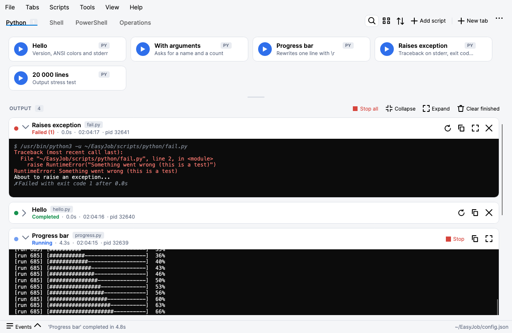
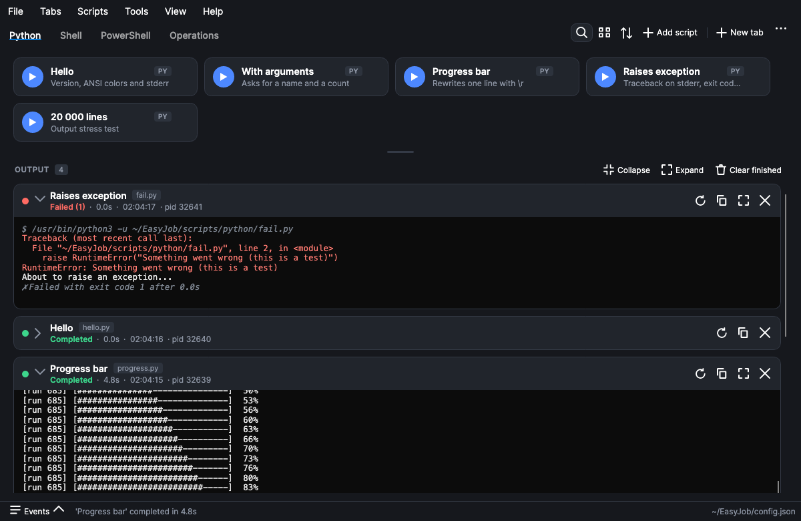
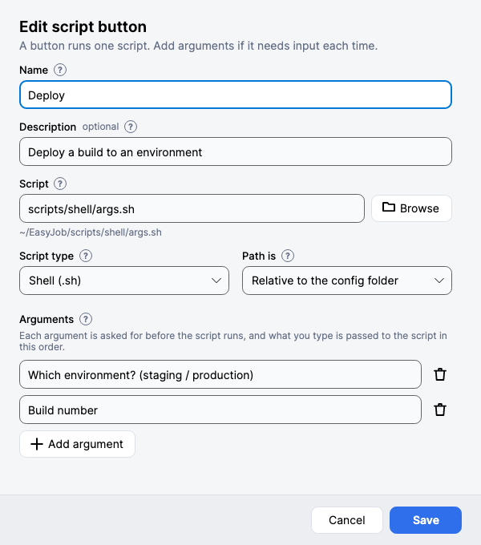
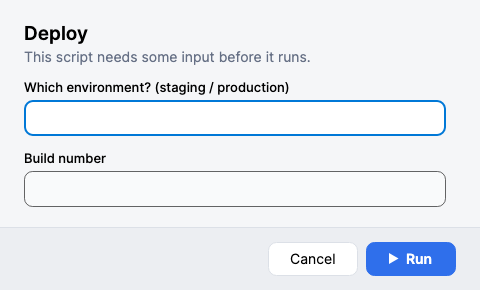
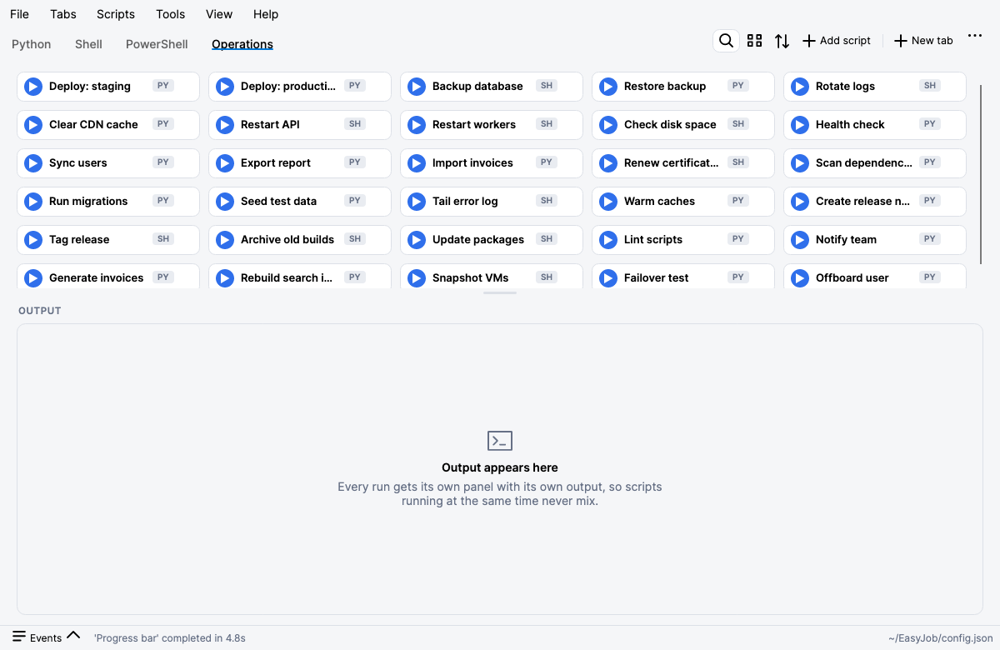
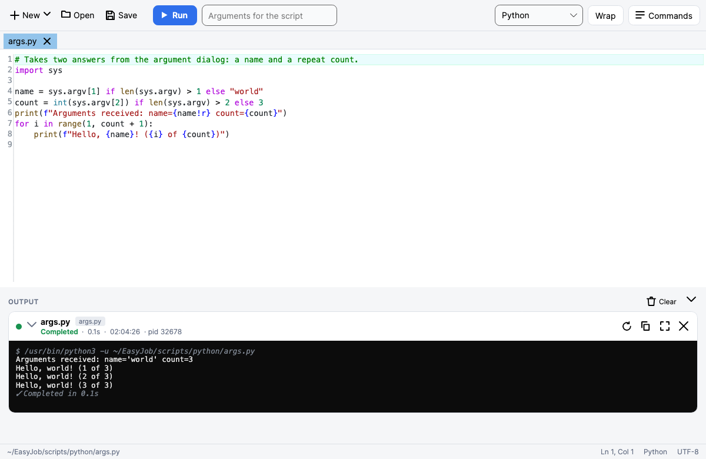
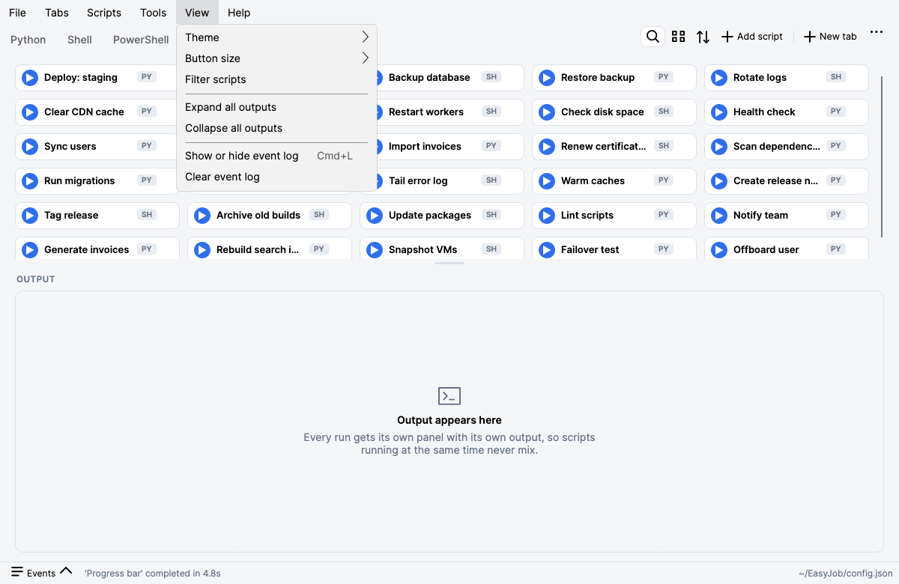

#  EasyJob

<a href="https://img.shields.io/github/license/akshinmustafayev/EasyJob">
  
</a>
<a href="https://img.shields.io/tokei/lines/github/akshinmustafayev/EasyJob">
  
</a>
<a href="https://img.shields.io/github/downloads/akshinmustafayev/EasyJob/total">
  
</a>
<a href="https://img.shields.io/github/stars/akshinmustafayev/EasyJob?style=social">
  
</a>
<a href="https://img.shields.io/github/contributors/akshinmustafayev/EasyJob">
  
</a>


## :newspaper: Description

EasyJob - keep and execute your PowerShell, Python, shell and BAT scripts from one interface. Runs on **Windows, macOS and Linux**.


<p align="center">
  
</p>

Every run gets its own card (status, duration, PID, its own output, Stop / Run again), so scripts running at the same time never mix. The same app also comes in a dark theme:

<p align="center">
  
</p>


## :rocket: What's new in 2.0
* Rebuilt on **.NET 10** and [Avalonia UI](https://avaloniaui.net), so the same app runs on Windows, macOS and Linux.
* A new **run panel** replaces the old rich-text console. Every execution gets its own card with status, duration, PID, its own output, and *Stop* / *Run again* / *Copy* / *Collapse* actions. Running several scripts at once no longer mixes their output.
* **Per-tab output**: each tab has its own list of runs. The same script can run several times at once, and *Run in tab* in the button's context menu sends a script's output to another tab.
* Proper **ANSI color** support (PowerShell, git, dotnet, npm, ...).
* **Python** scripts as a script type.
* **Script editor** (Tools → Script editor, or Shift+click a script button): multi-file tabs, syntax coloring for PowerShell, Python, shell, batch, JSON, YAML, XML and Markdown (follows the light/dark theme), find (Ctrl/Cmd+F), save, and **Run (F5)** with live output in a panel under the editor. Run uses what is in the editor right now, so you don't have to save first (unsaved text runs from a temporary copy that is removed when the editor closes).
* **Terminal** (Terminal button or Ctrl/Cmd+` in the script editor): a real terminal (pseudo-terminal plus xterm emulation) under the editor, in PowerShell or your system shell, starting in the open file's folder. Interactive programs, prompts, colours, `vim`, `top` and Ctrl+C all work as in any terminal. Built on [Iciclecreek.Avalonia.Terminal](https://github.com/tomlm/Iciclecreek.Avalonia.Terminal) (MIT).
* **Side panel** (right of the script editor, toggled with the button above it or Ctrl/Cmd+Shift+P) follows the language of the open file: PowerShell shows the command browser, JSON shows the file pretty-printed live (with a validity message and Copy), Markdown shows it rendered (headings, lists, tables, code, links; always on a light page), and other languages have no panel. The panel is resizable (drag the divider); its width is remembered while the editor is open. The **PowerShell command browser** (also Tools → PowerShell commands): search every cmdlet, function and alias of your installed PowerShell, read syntax, description and examples, copy or insert a command into the editor.
* A reorganised menu bar (File, Tabs, Scripts, Tools, View, Help) with keyboard shortcuts and a theme switch (system, light, dark).
* Ready-to-use **test scripts** (`EasyJob/scripts`) and a matching `config.json` for PowerShell, Python, shell and batch, including argument prompts, failures, progress bars and output stress tests.
* **Drag and drop** to reorder script buttons and tabs, right where they are. Tab and script actions (New tab, Add script, Reorder, Paste, rename/remove) are also one click away, no menu digging.
* Refreshed look with light/dark theme following the system, empty states, a collapsible event log, and a unified editor dialog with a file picker.

## :computer: Requirements and running
* [.NET 10 SDK](https://dotnet.microsoft.com/download) to build from source.
* [PowerShell 7 (`pwsh`)](https://learn.microsoft.com/powershell/scripting/install/installing-powershell) for `.ps1` scripts on macOS/Linux (Windows PowerShell also works on Windows).

```
dotnet run --project EasyJob
dotnet publish EasyJob -c Release -r osx-arm64   # or win-x64, linux-x64, ...
```

### Ready-to-use packages
Release zips come in two variants for Windows, Linux and macOS (x64 and arm64):

| Zip | What it is |
| --- | --- |
| `EasyJob-<version>-<platform>-portable.zip` | **Portable**: the .NET runtime is included, just unzip and run (about 46-48 MB) |
| `EasyJob-<version>-<platform>.zip` | Small (about 12-16 MB), needs the [.NET 10 runtime](https://dotnet.microsoft.com/download/dotnet/10.0) installed |

`<platform>` is `win-x64`, `win-arm64`, `linux-x64`, `linux-arm64`, `osx-x64` or `osx-arm64`. Windows and Linux zips unpack to an `EasyJob/` folder, macOS zips contain `EasyJob.app`.

**Build them yourself** (you only need the .NET 10 SDK; any one machine builds every platform):

```
build/build.sh                                  # macOS, Linux, Git Bash, WSL
.\build\build.ps1                               # Windows PowerShell
build/build.sh --rids "win-x64 osx-arm64" --variants portable   # just what you need
```

The zips land in `build/dist/`. All options are in [`build/README.md`](build/README.md).

### macOS notes
* **Pick the right zip**: `osx-arm64` for Apple Silicon (M1 and newer), `osx-x64` for Intel Macs. Prefer the `-portable` zip unless you already have the .NET 10 runtime (`brew install --cask dotnet`).
* **Unzip with Finder** (double-click) or `ditto -x -k EasyJob-*.zip .`, not the plain `unzip` command: the app's code signatures live in extended attributes that `unzip` drops.
* **First launch**: builds you download are not notarized, so macOS may say the app is damaged or from an unidentified developer. Remove the download quarantine once, then open it normally:
  ```
  xattr -dr com.apple.quarantine /path/to/EasyJob.app
  ```
  (or right-click the app, choose Open, then Open again). Move `EasyJob.app` to `/Applications` or `~/Applications` first. Apps you build yourself on your Mac are ad-hoc signed and open without this step.
* **Menu bar**: the menus live in the macOS menu bar at the top of the screen (EasyJob menu with About and Quit, then File, Tabs, Scripts, Tools, View, Help); shortcuts use Cmd. The script editor window has its own toolbar and shortcuts.
* **Config**: the sample `config.json` ships inside the app (`EasyJob.app/Contents/MacOS/config.json`) and is used as is, so your changes are saved there, and updates keep it. Delete that file (or use `dotnet run`) if you prefer `config.json` in your user application-data folder.
* **Scripts**: `.ps1` scripts need [PowerShell 7](https://learn.microsoft.com/powershell/scripting/install/installing-powershell-on-macos) (`brew install --cask powershell`); Python scripts need `python3`. Shell scripts run with `/bin/sh`, and the editor's Terminal tab starts your shell (`$SHELL`) or PowerShell.
* **Dock icon**: it is set from the app bundle; an unbundled `dotnet run` copy shows it too, after start-up.

Script types: `powershell` (`.ps1`), `python` (`.py`, run with `python3 -u`; set `default_python_path` to override), `cmd` (`.bat`/`.cmd` on Windows, run with `/bin/sh` on macOS/Linux) and `shell` (`.sh`).

**Config location.** If a `config.json` sits next to the executable it is used (portable mode); otherwise the app uses `config.json` in your user application-data folder (shown in the status bar). Relative script paths are resolved against the folder that contains `config.json`, and both `\` and `/` separators are accepted, so a config written on Windows works on macOS.

**Ctrl/Cmd + click** a script button to show the script in your file manager, **Shift + click** to open it. Right-click for more actions.

> `EasyJobPSTools` (dialogs for your scripts) is a PowerShell module that works on Windows, macOS and Linux; see below.


## :abacus: Features

### Buttons and tabs
* **Add script** (Ctrl/Cmd+N), **Reorder**, **Paste** and **Filter** (Ctrl/Cmd+F) are at the right end of the tab strip. Right-click a button for _Run in tab_, _Edit in script editor_, _Open with default app_, _Show in folder_, _Edit_, _Copy_ and _Remove_; right-click a tab to rename, remove or reorder it. Everything is saved to your `config.json` as you go.
* **Drag and drop** script buttons and tabs to reorder them.
* **Ctrl/Cmd + click** a button to show its script in your file manager, **Shift + click** to open it in the script editor.

<p align="center">
  
  
</p>

* **Arguments**: a button can ask for input every time it runs. Each argument has a prompt; what you type is passed to the script, in order.

### Lots of scripts
Buttons fill the row width. **View → Button size** switches between comfortable cards, a compact layout (about twice as many on screen) and Automatic (compact once a tab has more than 12 buttons; saved as `button_density`). Drag the grip under the script area to make it taller or shorter (double-click resets it), or use the filter.

<p align="center">
  
</p>

### Script editor
Tools → Script editor (or Shift+click a button): tabs, syntax coloring for PowerShell, Python, shell, batch, JSON, YAML, XML and Markdown (follows the theme), find, and **Run (F5)** with live output under the editor. Run uses exactly what is in the editor, so you do not have to save first. The PowerShell command browser docks on the right (Commands button, Ctrl/Cmd+Shift+P).

<p align="center">
  
</p>

### Menus and shortcuts
File, Tabs, Scripts, Tools, View and Help, with the shortcut next to each item. View has the theme (system, light, dark), button size, filter, expand/collapse outputs and the event log.

<p align="center">
  
</p>

### Colors
Output colors are whatever your script or tool prints: ANSI colors (git, dotnet, npm, Python, ...) and, for PowerShell, its own colors (errors, tables, `Write-Host -ForegroundColor`). The option "Use PowerShell's own colors in output" in Tools → Configuration controls the PowerShell part.

### Updates
EasyJob checks the GitHub releases when it starts (switch it off in Configuration, or use Help → Check for updates). When a newer release exists an **Update to x.y.z** button appears in the menu bar; it downloads the release zip, shows the release notes, then restarts into the new version and keeps your `config.json`. Each release must carry a `.zip`; if there are several, the one whose name contains your OS (`win`, `osx`/`macos`, `linux`) and CPU (`x64`, `arm64`) is used. The app folder must be writable, and a `dotnet run` development run cannot update itself.

### Troubleshooting
Help → Troubleshooting lists your system, runtime, config (including script files that are missing), interpreters, environment and recent events, with a copy button for bug reports.


## :hammer: EasyJobPSTools

EasyJobPSTools is a PowerShell module that gives your scripts real windows. EasyJob closes a script's stdin, so `Read-Host` cannot work; use these instead. It works on **Windows, macOS and Linux**: Windows Forms (or the ModernWpf input box when the DLLs are present) on Windows, AppleScript on macOS (nothing to install), and `zenity` on Linux.

```PowerShell
Import-Module (Join-Path $PSScriptRoot '../../EasyJobPSTools/EasyJobPSTools.psd1')

$name  = Show-EJInputBox -Header 'Deploy' -Text 'Your name?' -AllowEmptyResult $false
$env   = Show-EJSelectItem -Header 'Deploy' -Text 'Environment' -Items 'dev','staging','prod'
if (Show-EJConfirm -Header 'Deploy' -Text "Deploy to $env?" -DefaultNo) { ... }
```

| Function | What it does |
| --- | --- |
| `Show-EJInputBox` | Text input. `-DefaultValue`, `-Password`, `-AsSecureString`, `-AllowEmptyResult` |
| `Show-EJMessageBox` | Message with an Information / Warning / Error icon |
| `Show-EJConfirm` | Yes/No question, returns `$true`/`$false` (`-DefaultNo`) |
| `Show-EJSelectItem` | Pick one item, or several with `-MultiSelect` |
| `Show-EJSelectFileWindow` | Open-file window: `-FileType`, `-InitialDirectory`, `-MultiSelect` |
| `Show-EJSaveFileWindow` | Save-file window: `-DefaultName`, `-FileType` |
| `Show-EJSelectFolderWindow` | Folder picker |
| `Show-EJNotification` | Desktop notification |
| `Get-EJDialogBackend` | Which backend is in use (`$null` means no dialogs possible) |

Cancelling gives an empty result (`""`, an empty array, or `$false`); add `-ThrowOnCancel` to get an error instead. `-FileType` takes the Windows syntax (`"Text (*.txt)|*.txt|All files|*.*"`) or a plain list (`"*.txt;*.md"`). The build copies the module next to the app, so scripts in `scripts/powershell` can import `../../EasyJobPSTools/EasyJobPSTools.psd1` (see `dialogs.ps1`).

## :gear: Configuration

Everything is saved in `config.json` (see [Config location](#computer-requirements-and-running)); you can edit it by hand or use Tools → Configuration and the dialogs. A trimmed example:

```json
{
  "default_powershell_path": "",
  "default_python_path": "",
  "default_shell_path": "",
  "default_cmd_path": "",
  "powershell_arguments": "",
  "console_background": "#0C0C0C",
  "console_foreground": "#E6E6E6",
  "powershell_native_colors": true,
  "editor_open_commands_panel": true,
  "editor_open_terminal": true,
  "theme": "system",
  "button_density": "auto",
  "check_updates_on_startup": true,
  "clear_events_when_reload": true,
  "restrictions": {
    "block_tabs_remove": false,
    "block_buttons_remove": false,
    "block_buttons_add": false,
    "hide_menu_item_settings_configuration": false
  },
  "tabs": [
    {
      "ID": "10000000-0000-4000-8000-000000000001",
      "Header": "Deploy",
      "Buttons": [
        {
          "Id": "00000000-0000-4000-8000-000000000001",
          "Text": "Deploy",
          "Description": "Deploy a build to an environment",
          "Script": "scripts/deploy.sh",
          "ScriptPathType": "relative",
          "ScriptType": "shell",
          "Arguments": [
            { "ArgumentQuestion": "Which environment?" },
            { "ArgumentQuestion": "Build number" }
          ]
        }
      ]
    }
  ]
}
```

* Interpreter paths (`default_powershell_path`, `default_python_path`, `default_shell_path`, `default_cmd_path`) can be left empty; EasyJob looks for `pwsh`/`powershell`, `python3`/`python` and `/bin/sh` itself. `powershell_arguments` are extra arguments passed to PowerShell.
* `ScriptType` is `powershell`, `python`, `shell` or `cmd`; `ScriptPathType` is `relative` (to the config folder) or `absolute`.
* `ArgumentQuestion` is the prompt text shown for an argument. Keys written by older versions (`argument_question`, lower-case names) still load.
* `theme` is `system`, `light` or `dark`; `button_density` is `auto` (compact once a tab has many buttons), `cards` or `compact`.
* `powershell_native_colors` shows PowerShell's own colors in the output; `console_background` / `console_foreground` take a color name or hex value.
* `editor_open_commands_panel` and `editor_open_terminal` (both default `true`) decide whether the script editor opens with the side panel and the terminal showing; `check_updates_on_startup` looks for a newer release when EasyJob starts.
* `restrictions` lock down or hide parts of the UI (useful when you hand a prepared config to a team). The complete list, with what each one does, is in [Administration](#lock-administration-restricting-what-users-can-do); `EasyJob/config.json` has every key with its default.
* `ID`/`Id` can be any GUID, or left out; EasyJob generates one.


## :lock: Administration: restricting what users can do

For a managed rollout you can ship a ready `config.json` and limit what people may do with EasyJob. There are two layers:

1. **`restrictions` in `config.json`**: convenient, and the Tools → Configuration → Restrictions tab edits them, but a user who can edit the file can switch them off again.
2. **An administrator policy (`policy.json`)**: a file only an administrator can write. It is merged over the user's restrictions every time the config loads, so users cannot turn anything off (not in the UI, not in `config.json`). A restriction switched on by any layer stays on. The footer then shows a **Managed** badge, and the Configuration dialog shows policy-set options locked.

EasyJob reads every policy file it finds, in these places:

| Platform | Machine-wide file |
| --- | --- |
| Windows | `%ProgramData%\EasyJob\policy.json` |
| macOS | `/Library/Application Support/EasyJob/policy.json` |
| Linux | `/etc/easyjob/policy.json` |

plus `policy.json` next to the program, and a file named in the `EASYJOB_POLICY` environment variable. Put the machine-wide file where only administrators can write. A policy file that cannot be parsed locks EasyJob down (read-only config, no editor, no updates) instead of being ignored. See [`policy.example.json`](policy.example.json). The file has the same shape as `config.json`; only its `restrictions` block is used.

**Settings** (all `false`/empty by default):

| Setting | Effect |
| --- | --- |
| `config_readonly` | Nothing can be changed or saved; all tab and button editing is blocked and EasyJob never writes `config.json` (theme and button size last for the session only) |
| `block_script_editor` | No script editor window at all (menus, Shift+click, "Edit in script editor"), and with it no command browser. It overrides the other editor settings below: while it is on, `script_editor_readonly`, `block_script_editor_run`, `block_script_editor_open_files` and `block_powershell_commands` have nothing to apply to, so they are ignored (and shown off and locked in the Restrictions tab) |
| `script_editor_readonly` | The editor opens files for reading and running only (no typing, saving or new files) |
| `block_script_editor_run` | The editor has no Run button |
| `block_script_editor_open_files` | The editor only opens scripts from script buttons, not arbitrary files |
| `block_powershell_commands` | No PowerShell command browser |
| `block_editor_terminal` | No Terminal tab under the editor. The terminal is also unavailable whenever `block_script_editor_run`, `confirm_before_run`, `allowed_script_types` or `allowed_script_folders` are in effect, since a shell would bypass them |
| `block_open_script_externally`, `block_show_in_folder` | Removes "Open with default app" / "Show in folder" and Ctrl/Cmd+click |
| `block_updates` | No update checks, no update button, no self-update |
| `block_view_settings` | Theme and button size cannot be changed |
| `confirm_before_run` | Asks "Run this script?" before every run (buttons, editor, Run again) |
| `allowed_script_types` | e.g. `["powershell","python"]`: other script types cannot run or be added |
| `allowed_script_folders` | Scripts may only run, be added or be edited inside these folders (`{config}` = the config folder, `{home}` = the user's home; symbolic links are followed) |
| `max_concurrent_runs` | At most this many scripts run at once (0 = no limit) |
| `block_tabs_*`, `block_buttons_*` | Block adding, removing, renaming, reordering, editing, copying, pasting tabs and buttons |
| `hide_menu_item_*` | Hide menus and menu items (Tools, Configuration, Reload config, Open config folder, event log, Help items, ...) |

Limits are enforced where the action happens, not only by hiding menu items: a blocked script is refused when it starts whatever way it was launched (button, editor, Run again), the editor checks the folder rules on open and save, and keyboard shortcuts of hidden items do nothing.

**Typical locked-down setup:** a read-only `config.json` with your tabs and buttons, a machine-wide `policy.json` with `config_readonly`, `block_script_editor`, `block_updates` and `allowed_script_folders` pointing at your script share. Users can only click the buttons you give them.

_What this is not:_ EasyJob runs scripts with the user's own permissions, so these restrictions keep users inside the app's workflows; they are not an operating-system security boundary. Use file permissions on the script folders for that.


## :electric_plug: Compilation

1. Install the [.NET 10 SDK](https://dotnet.microsoft.com/download).
2. `dotnet build EasyJob.sln`, or `dotnet run --project EasyJob`.
3. Build release zips for every platform with `build/build.sh` (or `build\build.ps1` on Windows): Windows, Linux and macOS, x64 and arm64, each as a **portable** zip (runtime included) and a smaller one that needs the .NET 10 runtime. See [`build/README.md`](build/README.md). For a single platform you can also run `dotnet publish EasyJob -c Release -r win-x64` yourself.

**macOS app icon.** macOS takes the Dock and Finder icon from an `.app` bundle, not from the `.ico` used on Windows. EasyJob sets its Dock icon at start-up even when run unbundled (`dotnet run`, a publish folder), and `tools/make-macos-app.sh` wraps a publish folder into a proper `EasyJob.app` (with `Info.plist` and `icon.icns`):

```
dotnet publish EasyJob -c Release -r osx-arm64 --self-contained -o publish/osx-arm64
tools/make-macos-app.sh publish/osx-arm64 EasyJob.app 2.0.0
ditto -c -k --keepParent EasyJob.app EasyJob-osx-arm64.zip   # the release asset
```

`EasyJobPSTools` is plain PowerShell and is copied next to the app by the build; its optional ModernWpf input box (`EasyJobPSTools/EasyJobPSTools.sln`, Windows, Visual Studio) is not required.

## :dart: Contributing

Contribution is very much appreciated. Hope that this tool might be useful for you!

Thanks to the contributors:

<a href="https://github.com/akshinmustafayev/EasyJob/graphs/contributors">
  
</a>

